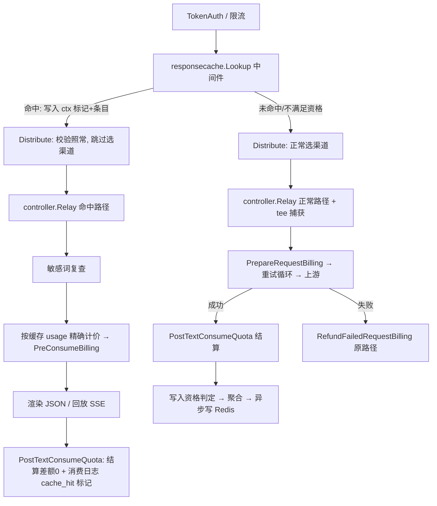

# 响应缓存（Response Cache）设计文档

- 日期：2026-11-02
- 状态：定稿待评审（未实施，不含代码）
- 范围：`/v1/chat/completions`（流式 + 非流式）
- 核心代码位置：`likha/code/responsecache/`（自研包，与上游物理隔离）

---

## 1. 背景与目标

中转站对重复问题每次都调用上游大模型，存在不必要的延迟与上游 token 成本。
本功能在网关侧对**字节级重复的请求**缓存完整响应：命中时直接返回缓存结果，
不再调用上游，但**计费、日志、限流、敏感词检查全部照常执行**。

### 目标

- 降低重复请求的首字延迟与上游调用量。
- 命中与未命中的计费结果对同一 usage 完全一致（同源计价）。
- 多节点部署下缓存共享、行为一致。
- 全链路 fail-open：缓存子系统任何故障都不得导致请求失败。


### 非目标（v1 明确不做）

- 语义缓存（embedding 相似度匹配）。
- embeddings / rerank / Claude / Gemini / Responses API / 图像 / 音频 / 异步任务。
- 跨用户全局共享、按模型/分组开关、独立命中率看板。
- Playground（`/pg`）请求。

---

## 2. 已确认的设计约束

| # | 约束 | 说明 |
|---|------|------|
| 1 | 按正常用量收费 | 命中时按存储的 usage 精确计费，不免费 |
| 2 | per-user 隔离 | cache key 含 userId，不同用户条目互不可见 |
| 3 | 三级开关 | 全局 > User > Token，任意一级关闭即不生效 |
| 4 | 确定性 | **全部缓存**，不区分 temperature / seed，API 流量中字节级重复多为程序重试/FAQ；接受重复提问失去随机多样性 |
| 5 | usage 损坏兜底 | usage 丢失/为零时收满额度（ModelPriceHelperPerCall） |
| 6 | TTL 默认 4 小时 | 按 token / 分组可配置，最小粒度为 Token 级 |
| 7 | n > 1 不读不写 | 多路输出请求跳过缓存 |
| 8 | 命中需在日志标记 | LogOther public 层写入 cache_hit=true |
| 9 | Token 开关仅管理员可设 | Token 创建/编辑 API 对普通用户忽略该字段 |
| 10 | User 开关在个人设置页 | 前端个人设置页配置，普通用户可自行关闭 |
| 11 | 接口范围 | 仅 `/v1/chat/completions`，流式 + 非流式，主流量入口，只需适配一种客户端响应格式 |
| 12 | 代码位置 | `likha/code/responsecache/` ，符合二次开发纪律第 3 条（自研代码物理隔离） |
| 13 | 挂载层 | 查询前置 + Relay 内命中服务（见 §4，含对早期口径的修正），计费/日志管线单一来源 |

---


## 3. 现状依据（已核实的代码事实）

| 事实 | 位置 |
|------|------|
| 仓库当前**没有** LLM 响应缓存；`middleware/cache.go` 仅是静态资源 HTTP 缓存头 | `middleware/cache.go` |
| Redis 读写原语现成 | `common/redis.go:64`（RedisSet）、`:72`（RedisGet） |
| 有界响应捕获包装器模式现成（tee + 上限缓冲） | `middleware/audit.go:19`（auditResponseWriter） |
| 结算+日志全流程单函数完成：按 usage 计价（含分层/工具附加费/音频）→ 用户与渠道用量统计 → SettleBilling → 日志 other 生成 → 饱和审计 → RecordConsumeLog | `service/text_quota.go:387`（PostTextConsumeQuota） |
| 计费会话生命周期：预扣（含信任旁路/钱包订阅偏好）→ 结算差额 → 幂等退款 | `service/billing_session.go` |
| 预扣费入口（估算 token → 定价 → PreConsumeBilling） | `relay/request_billing.go:24`（PrepareRequestBilling） |
| Relay 主循环：GenRelayInfo → PrepareRequestBilling → 重试循环 → RefundFailedRequestBilling | `controller/relay.go:68` |
| 渠道选择/令牌模型白名单/分组校验都在 Distribute 中间件内，先于 Relay 执行 | `middleware/distributor.go:34`；路由挂载 `router/relay-router.go:115` |
| SSE 回放可复用的生成器：起始空块/停止块/最终 usage 块/新响应 ID | `relay/helper/common.go:174,184,202,217` |
| chat 处理器内部存在 chat-via-responses 与音频计费分支 | `relay/compatible_handler.go:93` 附近 |
| 请求体可重复读（BodyStorage），Distribute 已依赖 | `common.GetBodyStorage` |
| 测试用 Redis 模拟器已在依赖中 | `github.com/alicebob/miniredis/v2`（go.mod） |

---

## 4. 架构与挂载点

### 4.1 备选方案对比

| 方案 | 结论 |
|------|------|
| A. 全部逻辑在 `controller.Relay` 内（含查缓存） | 部分采纳：命中后的计费/渲染/结算留在 Relay；但**查询**若放在 Relay 内则晚于 Distribute，存在两个问题（见 4.2） |
| B. 独立中间件完成命中+计费+日志 | 否决：复制整条计费管线，违反计费不变量单一来源原则 |
| C. 渠道适配器层缓存 | 否决：触碰 40+ 适配器，同用户跨渠道无法共享 |

### 4.2 定稿挂载（A′）：查询前置 + Relay 内命中服务

> **对早期讨论口径的修正**：此前表述为"命中时不选渠道、钩子在 GenRelayInfo 之后"。
> 核实路由顺序后发现 `middleware.Distribute` 先于 `controller.Relay` 执行，
> 若查询放在 Relay 内：
> 1. 渠道全部不可用时 Distribute 直接 503，缓存永远无法命中（失去故障期价值）；
> 2. 命中请求仍会做一次渠道选择并污染亲和性统计。
> 因此定稿将**查询**前置到 Distribute 之前，**命中后的服务**（计费/渲染/结算/日志）仍在 Relay 内。
> Distribute 的全部校验（令牌模型白名单、分组权限、约束过滤）照常执行，仅跳过渠道选择本身。



### 4.3 组件划分

| 组件 | 位置 | 职责 |
|------|------|------|
| `responsecache` 包 | `likha/code/responsecache/`（新建） | 键规范化、条目编解码与校验、Redis 存取、SSE 聚合、响应渲染、tee 写入器、Lookup 中间件、命中服务入口 |
| 设置组 | `setting/operation_setting/`（新增文件，沿用现有设置组模式） | enabled / ttl_seconds / max_entry_bytes / version 的读取与默认值 |
| 上游薄钩子 | 见 §9 清单 | 路由挂载、Distribute 跳过分支、Relay 命中/写入触发、RelayInfo 字段、结算点取数与日志标记 |

包内 JSON 一律使用 `common.Marshal / common.Unmarshal`（根模块纪律）。
该包属于根模块，**不触碰 relaykit / tokenkit**，两独立模块无需重新验证构建。

---

## 5. 详细设计

### 5.1 缓存键

```
resp_cache:{version}:{userId}:{sha256(body')}
```

- `body'` = 原始请求体字节，仅删除顶层 `stream` 与 `stream_options` 两个字段
  （用 `tidwall/sjson`，已在依赖中）；**其余字节原样保留，不做 JSON 规范化**。
  键序/空白不同的同义请求视为未命中（保守策略，无语义丢失风险）。
- `version` 来自设置（默认 1）。管理端"清空缓存"= version+1，
  旧条目随 TTL 自然过期，无需 SCAN/DEL 大键。条目结构演进也通过 version 隔离。
- `userId` 取 `c.GetInt("id")`（TokenAuth 之后可用），与 `RelayInfo.UserId` 同源。
- 模型名在 body 内，已被哈希覆盖；令牌 ID、分组**不进键**
  （按用户隔离；分组只影响命中时点计价，不影响答案内容资格）。
- 流式与非流式同键：同一问题的两种传输形式共享一条缓存。

### 5.2 缓存条目

Redis 值为 JSON（`common.Marshal`），结构：

```json
{
  "v": 1,
  "model": "gpt-4o",
  "choices": [ { "message": { "role": "assistant", "content": "...", "tool_calls": [] }, "finish_reason": "stop" } ],
  "usage": { "prompt_tokens": 0, "completion_tokens": 0, "total_tokens": 0, "...": "完整 dto.Usage，含 UsageSemantic 与 details" },
  "origin_channel_id": 12,
  "created_at": 1730000000
}
```

- **只存 usage，绝不存 quota/价格/倍率**（D1：价格命中时点重算）。
- `usage` 以结算点的权威值为准（`RelayInfo.FinalUsage`，见 5.5），
  不依赖客户端是否收到 usage 块。
- 不存 `id` / `created` / `system_fingerprint`：渲染时新生成。
- 读取时校验：`v` 匹配、usage 各 token 字段 ≥ 0 且处于合理上界、choices 非空。
  校验失败 → 当未命中 + 异步删除该键（防御损坏/异常条目，符合计费纵深防御要求）。

Redis 存储值为 JSON 序列化的 `CachedResponse`（存放于 `service/response_cache.go`）：

```go
type CachedResponse struct {
    // 完整的 OpenAI Chat Completion 响应体（非流式格式），原始 JSON bytes
    Body []byte `json:"body"`

    // 用于计费的 usage（来自原始响应）
    Usage struct {
        PromptTokens     int `json:"prompt_tokens"`
        CompletionTokens int `json:"completion_tokens"`
        TotalTokens      int `json:"total_tokens"`
    } `json:"usage"`

    // 写入时的元信息
    Model     string `json:"model"`
    CreatedAt int64  `json:"created_at"`
}
```

### TTL 决策（resolveResponseCacheTTL）

```
Token.Settings.ResponseCacheTTLSeconds > 0  →  Token 级 TTL
User.Settings.ResponseCacheTTLSeconds > 0   →  User 级 TTL
GlobalResponseCacheSetting.DefaultTTLSecs   →  全局默认（14400 s = 4 h）
```
---

### 5.3 命中路径（Relay 内）

前置：Lookup 中间件命中并在 ctx 标记；Distribute 完成全部校验但跳过选渠道
（ChannelId 上下文为 0）；`GenRelayInfo` 正常执行。

1. **敏感词复查**：与 `PrepareRequestBilling` 相同的 `service.CheckSensitiveText`
   逻辑照常执行（词库可能已更新）；命中敏感词 → 走既有拒绝路径，不计费。
2. **精确计价**：以缓存 usage 调用与 `PostTextConsumeQuota` 同源的计价逻辑
   （`calculateTextQuotaSummary` + 分层表达式 + 当前分组倍率），得到精确 quota。
   需要在 service 侧新增一个薄导出入口（见 §9），不复制计价公式。
   注意：命中路径没有渠道选择，`PriceData.GroupRatioInfo` 不会由 `getChannel`
   建立，薄入口必须自行调用 `helper.HandleGroupRatio`（`relay/helper/price.go:43`）
   取得当前分组倍率。
3. **预扣费**：`service.PreConsumeBilling(c, 精确quota, info)` —— 完整复用
   BillingSession 的钱包/订阅偏好、信任旁路、额度不足拒绝。免费模型 quota=0 照常跳过。
4. **渲染响应**：
   - 非流式：构造 `chat.completion` JSON（新 `id`/`created`，缓存 choices + usage）。
   - 流式：用 `relay/helper` 现有生成器重放为 SSE：起始块（role）→ 内容块
     （合成少量分块，**不保证原始 chunk 边界**）→ tool_calls 块（如有）→
     停止块（finish_reason）→ usage 块（按与 compatible_handler 相同规则判定的
     `ShouldIncludeUsage`，含 ForceStreamOption）→ `[DONE]`。
5. **结算与日志**：`service.PostTextConsumeQuota(c, info, 缓存usage, nil)`：
   - `SettleBilling` 差额为 0（精确预扣）；
   - 用户用量/请求数统计照常；**渠道用量统计跳过**（ChannelId=0）；
   - 消费日志照常落库：`channel_id=0`、`other.cache_hit=true`（public）、
     `other.admin_info.cache_origin_channel_id`（admin-only，避免向普通用户暴露渠道拓扑）；
   - 饱和审计 `attachQuotaSaturation` 自动继承。
6. **策略与指标**：`MarkRequestPolicySuccess`、`perfmetrics.RecordRelayResult`
   走既有 defer 路径。实施时需验证 RequestPolicy 记录器容忍"无 BeginAttempt"
   的成功记录（见 §11 风险）。
7. 命中路径**不进入重试循环、不调用上游、不安装 tee**。

限流说明：`ModelRequestRateLimit` 在 Lookup 之前已执行，命中照常计数。


8. 命中计费路径

缓存命中时**跳过** `BillingSession`（无预扣/退款流程），直接调用：

```go
err := service.PostConsumeQuota(relayInfo, quota, 0, false)
```

`quota` 由存储的 `usage` + `ModelPriceHelper` 计算：

```go
priceData, err := helper.ModelPriceHelper(c, relayInfo,
    cachedResp.Usage.PromptTokens, nil)
// 用 priceData 计算最终 quota（与正常结算路径一致）
```

**usage 损坏兜底**：若 `cachedResp.Usage.TotalTokens == 0`，调用 `ModelPriceHelperPerCall` 收取满额度：

```go
if cachedResp.Usage.TotalTokens == 0 {
    priceData, err = helper.ModelPriceHelperPerCall(c, relayInfo)
    quota = priceData.Quota
}
```


9. 流式请求的缓存策略

【写入时】

流式响应（`IsStream = true`）在 `DoResponse` 完成后，由 adaptor 将 SSE delta 合并为一个完整的非流式 `OpenAITextResponse`，与非流式统一存储同一种格式。

【命中时回放(ServeCachedResponse)】

- **非流式请求**：将 `CachedResponse.Body` 直接写回，状态码 200，`Content-Type: application/json`。
- **流式请求**（`relayInfo.IsStream == true`）：将存储的非流式 body 拆成单条 SSE 事件一次性写出：

```
data: {"id":"cache-<hash8>","object":"chat.completion.chunk","choices":[{"index":0,"delta":{"role":"assistant","content":"<full_content>"},"finish_reason":"stop"}],"model":"<model>"}

data: [DONE]

```

`id` 前缀固定为 `cache-`，便于客户端和日志区分。响应头设置 `Content-Type: text/event-stream`。


---

### 5.4 写入路径（未命中且成功）

1. **tee 安装**：Relay 开始处，若请求级资格满足（路径为 `/v1/chat/completions`
   + OpenAI 格式 + 非 playground + 开关开 + Redis 可用；**不含 legacy
   `/v1/completions`**），用 `responsecache` 提供的有界写入器包装
   `c.Writer`（复用 auditResponseWriter 模式：上限缓冲、透传 Write/Flush、
   记录状态码），defer 恢复。与现有 writer 包装按洋葱模型兼容。
2. **结算点取数**：`PostTextConsumeQuota` 内把权威 usage 写入
   `RelayInfo.FinalUsage`（新增字段），并标记结算期资格（见下）。
3. **写入资格**（全部满足才写）：
   - 重试循环最终成功（`newAPIError == nil`），HTTP 200；
   - `FinalUsage` 非空且通过 5.2 的读取校验同等规则；
   - usage 无 audio tokens（v1 不复刻 PostAudioConsumeQuota 分支）；
   - 无内置工具附加费（chat-via-responses 带工具计数的请求不缓存）；
   - 非 passthrough（全局或渠道级 PassThroughBody 开启时响应形状不保证）；
   - 流式：捕获到完整结束（finish + `[DONE]`）；客户端中断不缓存；
   - 序列化后条目 ≤ `max_entry_bytes`（默认 256KB）。
4. **聚合**：非流式解析捕获 JSON 取 choices；流式解析捕获的 SSE
   （客户端-facing 恒为 OpenAI chunk 格式，与上游渠道无关）聚合
   content / tool_calls / finish_reason。usage 一律用 `FinalUsage`。
5. **异步写入**：`gopool.Go` 写 Redis（SET + TTL），失败仅 `logger.LogWarn`，
   绝不影响已完成的响应。写入前再次校验条目大小。

### 5.5 上游新增字段

`relay/common/relay_info.go` 的 `RelayInfo` 增加：

- `FinalUsage *dto.Usage`：结算点填充的权威用量（写缓存取数）。
- `CacheHit bool`：命中路径标记（日志 other 生成读取）。
- 结算期不可缓存原因标记（audio / 工具附加费），由 `PostTextConsumeQuota` 判定填充。

重试循环开始时这些字段随既有 per-attempt 重置逻辑一并处理，
避免上一次尝试的状态泄漏到下一次。

### 5.6 设置与存储

| 设置项 | 默认值 | 说明 |
|--------|--------|------|
| `response_cache.enabled` | `false` | 总开关；关闭时 Lookup/tee 全部 no-op |
| `response_cache.ttl_seconds` | `14400`（4h） | 条目 TTL |
| `response_cache.max_entry_bytes` | `262144`（256KB） | 条目上限，超限不写 |
| `response_cache.version` | `1` | 键版本；"清空缓存"按钮 +1 |

- 走现有 option map 持久化与 `SyncOptions` 热更新，**无新表、无迁移**。
- **依赖 Redis**：`common.RedisEnabled=false` 时功能自动禁用并打启动日志
  （多节点共享必须走 Redis，不做内存兜底，避免节点间行为不一致）。
- 管理端"运营设置"新增卡片（开关/TTL/上限/清空按钮），en/zh i18n，
  复用 `web/src/components/` 现有组件（实施前按纪律读 `web/AGENTS.md` 与 shadcn-ui skill）。
- 清空/开关变更经现有 option 更新 API，无需新增后端端点。

### 5.7 错误处理（fail-open 矩阵）

| 故障 | 行为 |
|------|------|
| Redis 不可用 / 超时 | Lookup 当未命中；写入跳过并告警日志 |
| 条目损坏 / 校验失败 | 当未命中 + 异步删除该键 |
| 聚合 / 序列化失败 | 放弃写入，记日志 |
| 命中路径计价 / 预扣失败 | 走既有错误响应（与正常请求额度不足一致），**不回落上游**（避免计费歧义） |
| tee 缓冲溢出 | 停止捕获，该请求不写缓存，响应不受影响 |

原则：缓存只允许"少命中"，不允许"多失败"。唯一例外是命中后的计费拒绝，
那是正常业务语义（额度不足），不是缓存故障。


### 5.8 三级开关设计

```
全局开关  GlobalResponseCacheEnabled
  └── User 级开关  UserSetting.ResponseCacheEnabled
        └── Token 级开关  TokenSettings.ResponseCacheEnabled
```

优先级：任意一级为 false 即禁用，全部为 true（或 nil 继承）才生效。

| 全局 | User | Token | 结果 |
|------|------|-------|------|
| off  | any  | any   | 不缓存 |
| on   | off  | any   | 不缓存 |
| on   | on   | off   | 不缓存 |
| on   | on   | on    | **缓存生效** |
| on   | on   | nil   | **缓存生效**（Token 未配置时继承 User） |

#### 5.8.1 全局开关

新建文件：`setting/operation_setting/response_cache_setting.go`

```go
package operation_setting

import "github.com/QuantumNous/new-api/setting/config"

type ResponseCacheSetting struct {
    Enabled        bool  `json:"enabled"`
    DefaultTTLSecs int64 `json:"default_ttl_secs"` // 默认 14400（4 小时）
}

var responseCacheSetting = ResponseCacheSetting{
    Enabled:        false,
    DefaultTTLSecs: 14400,
}

func init() {
    config.GlobalConfig.Register("response_cache_setting", &responseCacheSetting)
}

func GetResponseCacheSetting() *ResponseCacheSetting {
    return &responseCacheSetting
}
```

管理员在运维设置页维护，与 QuotaSetting 注册模式完全一致。

#### 5.8.2 User 级开关

修改文件：`relaykit/dto/user_settings.go`，在 `UserSetting` struct 末尾追加：

```go
// 响应缓存：用户个人开关（nil = 跟随全局默认 off）
ResponseCacheEnabled *bool `json:"response_cache_enabled,omitempty"`
// 自定义 TTL（秒），0 = 跟随全局默认
ResponseCacheTTLSeconds int64 `json:"response_cache_ttl_seconds,omitempty"`
```

前端入口：个人设置页（User Settings），普通用户可自行关闭，不可超过全局上限。

#### 5.8.3 Token 级开关

新建文件：`dto/token_settings.go`

```go
package dto

type TokenSettings struct {
    // nil = 继承 User 设置
    ResponseCacheEnabled *bool `json:"response_cache_enabled,omitempty"`
    // 0 = 继承 User 设置
    ResponseCacheTTLSeconds int64 `json:"response_cache_ttl_seconds,omitempty"`
}
```

修改文件：`model/token.go`，在 `Token` struct 末尾新增字段并加两个辅助方法：

```go
// Settings 序列化为 JSON 的 TokenSettings，空字符串等价于全部继承
Settings string `json:"settings" gorm:"type:text;default:''"`
```

```go
func (t *Token) GetSettings() (*dto.TokenSettings, error) {
    if t.Settings == "" {
        return &dto.TokenSettings{}, nil
    }
    var s dto.TokenSettings
    if err := common.UnmarshalJsonStr(t.Settings, &s); err != nil {
        return nil, err
    }
    return &s, nil
}

func (t *Token) SetSettings(s *dto.TokenSettings) error {
    if s == nil {
        t.Settings = ""
        return nil
    }
    data, err := common.Marshal(s)
    if err != nil {
        return err
    }
    t.Settings = string(data)
    return nil
}
```

GORM AutoMigrate 自动加列，存量 Token 的 Settings 为空字符串，等价于全部继承。

**权限约束**：Token 创建/编辑 API 中，`settings.response_cache_enabled` 字段仅 `role >= RoleAdmin` 的请求者可写；普通用户提交时后端静默忽略该字段。


---

## 6. 计费与安全合规

对照 `.agents/rules/billing.md`（已完整阅读）：

- **单一计价来源**：命中路径复用 `calculateTextQuotaSummary` / 分层表达式 /
  `SettleBilling` / `PostTextConsumeQuota`，不新增平行计费公式。
- **饱和与审计**：quota 转换走 `common.QuotaFromFloatChecked` 等既有钳制路径，
  `attachQuotaSaturation` 由复用的结算函数自动继承；不引入裸 cast。
- **无负扣费**：预扣值来自既有计价路径；缓存 usage 读取时做非负与上界校验。
- **乘数守卫**：不直接写 `PriceData.OtherRatios`；命中请求体与写入时字节一致，
  `max_tokens` 等乘数在首次请求已经过既有校验。
- **隐私隔离**：键含 userId，条目不跨用户；Redis 中存有用户对话内容，
  访问边界与现有 Redis 缓存一致，TTL 4h 限制滞留时间。
- **敏感词**：命中时复查，词库更新即时生效。
- **令牌模型白名单 / 分组权限**：Distribute 校验照常执行（Lookup 命中不绕过）。
- **限流 / 审计**：命中照常计入模型限流；消费日志完整可审计（cache_hit 标记）。

---

## 7. 已知限制（明示接受）

1. 渠道 `param_override` / 模型映射差异：缓存答案来自首次服务的渠道，
   与另一渠道本会产生的答案可能不同。按用户隔离限制影响面；D3 已接受非确定性语义。
2. 重复提问不再有随机多样性（D3）。
3. 字节级键：JSON 键序 / 空白差异不命中。
4. v1 不缓存：audio tokens 用量、内置工具附加费请求、passthrough 渠道、
   playground、异步任务、其他协议端点。
5. 命中率预期：多轮对话（上下文逐轮变化）几乎不命中；
   收益集中在固定 system prompt 的短查询、FAQ、程序化重试。
6. 上游厂商自身的 prompt caching（如 Anthropic cache_control）与本功能正交，
   照常透传，互不影响。

---

## 8. 可观测性与运维

- **日志**：命中时 `logger.LogInfo` 一条（request id、键哈希前缀、origin channel）；
  消费日志 `other.cache_hit=true` 可供管理端日志页过滤与命中率统计。
  v1 不做独立统计端点/看板。

缓存命中时，在 `LogOther` 的 **public** 层写入标记（所有角色可见）：

```go
other.SetPublic("cache_hit", true)
```

同时在 adminInfo 层补充 key hash 后 8 位，便于排查重复/碰撞：

```go
other.SetAdmin("cache_key_suffix", cacheKey[len(cacheKey)-8:])
```

日志中体现：普通用户可见 `cache_hit: true`；管理员额外可见 `admin_info.cache_key_suffix`。


- **灰度**：默认关闭 → dev（dev.likha.hk）开启观察命中率与计费日志 → prod。
- **止血**：关闭开关（option 热更新，秒级生效）；清空缓存（version+1）。
- **回滚**：功能整体回滚 = 关开关；代码回滚不影响存量数据（无 schema 变更）。

---

## 9. 上游改动清单（实施时逐条登记 UPSTREAM_CHANGES.md + likha/ops/patches/）

| # | 文件 | 改动 | 性质 |
|---|------|------|------|
| U1 | `router/relay-router.go` | httpRouter 组在 Distribute 前挂载 `responsecache.Lookup()` | 1 行 |
| U2 | `middleware/distributor.go` | ctx 存在命中标记时：校验照常、跳过选渠道与亲和性记录 | ~5 行 |
| U3 | `controller/relay.go` | 命中分支（调 responsecache 命中服务）；未命中安装 tee；成功后触发写入 | 薄钩子 |
| U4 | `relay/common/relay_info.go` | `FinalUsage` / `CacheHit` / 不可缓存标记字段 + per-attempt 重置 | 字段 |
| U5 | `service/text_quota.go` | 结算点填充 FinalUsage 与资格标记；导出"按已知 usage 计价"薄入口；ChannelId=0 跳过渠道用量；日志 other 增加 cache_hit / admin_info.cache_origin_channel_id | 小改 |
| U6 | `model/option.go` | `InitOptionMap` 注册 response_cache 设置组 + 选项更新校验分支（沿用 `operation_setting.ValidateQuotaOption` 模式） | 登记 |
| U7 | `setting/operation_setting/` | 新增设置组文件（沿用现有模式） | 新文件 |
| U8 | `web/src/features/system-settings/` + `web/src/i18n/locales/en.json`、`zh.json` | 运营设置卡片 + i18n | 前端 |
| U9 | `UPSTREAM_CHANGES.md` | 追加本清单各行 + 复现补丁 | 纪律 |

注意：`UPSTREAM_CHANGES.md` 现引用的 `likha/ops/`、`likha/code/cmd/` 在当前树中不存在，
实施切片 5 需补建 `likha/ops/patches/` 并核对清单一致性。

**自研新增**（不算上游改动）：`likha/code/responsecache/` 包及其唯一测试文件、
`likha/docs/`（本文档）。

---

## 10. 实施切片（每片独立可验证，TDD 推进）

| 切片 | 内容 | 验收标准 |
|------|------|----------|
| S1 | 缓存包骨架：键规范化、条目编解码+校验、Redis 存取、设置组（U6/U7） | 单测：stream/stream_options 剔除后同键；版本/userId 隔离；损坏条目拒绝；miniredis 存取+TTL |
| S2 | 命中路径：Lookup 中间件 + Distribute 跳过分支 + Relay 命中服务 + 计价薄入口（U1/U2/U3/U4/U5 部分） | 单测：命中计费与未命中同 usage 同价一致；价格/分组倍率变更后重算；敏感词拦截；SSE 回放格式与 usage 块规则；额度不足拒绝 |
| S3 | 写入路径：tee + SSE 聚合 + FinalUsage + 资格判定 + 异步写入（U3/U4/U5 其余） | 单测：完整流写入；中断不写；audio/附加费/passthrough/超限不写；写失败不影响响应 |
| S4 | 管理端卡片 + i18n（U8） | 前端组件测试；en/zh 文案；开关/清空走现有 option API |
| S5 | 收尾：回归测试整合、UPSTREAM_CHANGES.md 登记、补建 likha/ops/patches/（U9） | 清单与补丁齐全；全量测试绿 |

---

## 11. 测试与验证计划

遵循 AGENTS.md 后端测试纪律（一个小功能最多一个新测试文件）：

- **新包唯一测试文件** `likha/code/responsecache/cache_test.go`：
  键规范化、条目校验、聚合、渲染、资格判定、fail-open（miniredis 模拟 Redis 故障）。
- **计费一致性用例**优先并入现有 `service/text_quota_test.go`（如现有夹具可复用），
  避免跨层重复建测试文件。
- 关键回归清单：
  1. 同 usage 同价格下，命中与未命中扣费、日志 quota 完全一致；
  2. 模型价格/分组倍率/分层表达式变更后，命中按新价计费；
  3. 流式回放：chunk 序列合法、finish_reason 正确、include_usage 两种取值；
  4. 敏感词库更新后命中被拦截；
  5. 令牌模型白名单在命中路径仍生效（Distribute 校验不绕过）；
  6. Redis 故障 / 损坏条目 / 写失败 → 请求正常完成；
  7. 客户端中断、audio、工具附加费、passthrough、超 256KB → 不写入；
  8. TTL 过期、version+1 后旧键不再命中；
  9. 免费模型命中 0 扣费且日志照常。
- **数据库**：无 schema 变更、无迁移；设置走既有 option CRUD。
  不触发三库验证矩阵；若实施中确需触碰模型/迁移，按 AGENTS.md 补
  SQLite/MySQL/PostgreSQL 全矩阵并记录版本与命令。
- **独立模块**：relaykit / tokenkit 零改动，无需 GOWORK=off 重验（实施后确认）。
- **前端**：`bun run typecheck` / `lint` / `test` 按 web/AGENTS.md。
- 命令与结果在实施 PR 中如实记录。

### 实施期需验证的风险点

| 风险 | 验证方式 |
|------|----------|
| RequestPolicy 记录器容忍无 BeginAttempt 的成功/终止记录 | 读 service/request_policy.go + 单测 |
| 命中路径 `PostTextConsumeQuota` 依赖的 RelayInfo/PriceData 字段是否已由 GenRelayInfo 初始化（GroupRatioInfo 除外，见 §5.3） | 对照正常路径逐字段核对 + 计费一致性单测 |
| RecordConsumeLog / 日志 UI 对 channel_id=0 的展示 | 现有失败日志已用 0，核对 UI 兜底 |
| tee 与 SSE Flush、gzip、audit 包装的叠加兼容 | 集成测试：流式命中/未命中各一轮 |
| Distribute 跳过分支不影响 pinned/约束过滤语义 | 单测覆盖 pinned 与命中互斥场景 |

---

## 12. 后续演进（不在 v1 范围）

- embeddings / rerank（确定性高、非流式，收益/成本比好）。
- Claude / Gemini / Responses 协议（每协议独立渲染与 usage 形状）。
- 按模型/分组开关、命中率看板、跨用户全局共享（需另行评估隐私与一致性）。
- 语义缓存（embedding 相似度）：独立立项，不与精确匹配混做。